<!-- Ganti semua "USERNAME", "NAMA KAMU", dan link repo sesuai milikmu. -->

  

  

 

## Tech Stack

  

## Projects

| Project | Deskripsi | Stack |
| --- | --- | --- |
| [AutoBekas Marketplace](https://github.com/USERNAME/NAMA-REPO) | Platform jual-beli mobil bekas | PHP, PostgreSQL |
| [SIMPUS-Mini](https://github.com/USERNAME/NAMA-REPO) | Sistem informasi perpustakaan sederhana | PHP, HTML, CSS |
| [PICO Canteen Order](https://github.com/USERNAME/NAMA-REPO) | Aplikasi pemesanan kantin (proyek PBL) | Web |

## Currently

- Mendalami PostgreSQL (function, view, stored procedure)
- Belajar Arduino dan dasar IoT
- Latihan OOP dengan Java

## Contribution Snake

  <picture>
    <source media="(prefers-color-scheme: dark)" srcset="https://raw.githubusercontent.com/USERNAME/USERNAME/output/github-snake-dark.svg" />
    <source media="(prefers-color-scheme: light)" srcset="https://raw.githubusercontent.com/USERNAME/USERNAME/output/github-snake.svg" />
    
  </picture>

## GitHub Stats

  
  

  

## Contact

[LinkedIn](https://linkedin.com/in/USERNAME) · [Email](mailto:emailkamu@gmail.com) · [Instagram](https://instagram.com/USERNAME)

