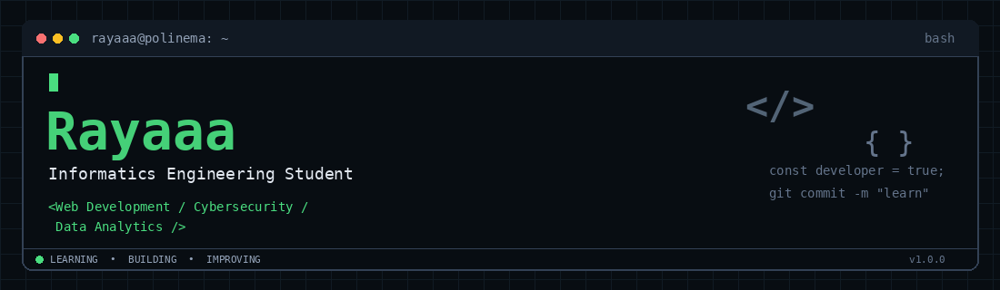

  

  

 

##  About Me

I'm an Informatics Engineering student at Polinema with an interest in web development, cybersecurity, and data analytics. Currently, I'm focusing on web development while gradually exploring other areas of technology and strengthening my programming fundamentals.

##  Currently Working With

  

##  Currently Exploring

  

##  Tools

  

##  Projects

| Project | Description | Tech Stack |
|---|---|---|
| AutoBekas Marketplace | Platform jual-beli mobil bekas | PHP, PostgreSQL |
| SIMPUS-Mini | Sistem informasi perpustakaan sederhana | PHP, HTML, CSS |
| PICO | Proyek aplikasi web pemesanan kantin | Web Development, Database |

<!-- Tambahkan link repository asli pada nama project di atas jika sudah tersedia. -->

##  Currently Learning

- PostgreSQL: Functions, Views, and Stored Procedures
- Java: Object-Oriented Programming
- Web Development: Frontend and Backend
- Arduino and Basic IoT

##  Contribution Snake

  <picture>
    <source
      media="(prefers-color-scheme: dark)"
      srcset="https://raw.githubusercontent.com/Alfathraya666/Alfathraya666/output/github-snake-dark.svg" />
    <source
      media="(prefers-color-scheme: light)"
      srcset="https://raw.githubusercontent.com/Alfathraya666/Alfathraya666/output/github-snake.svg" />
    
  </picture>

##  GitHub Stats

  

  

  

## 📫 Contact

  

